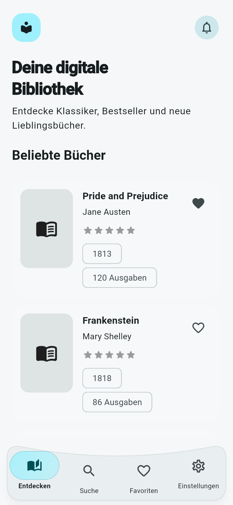
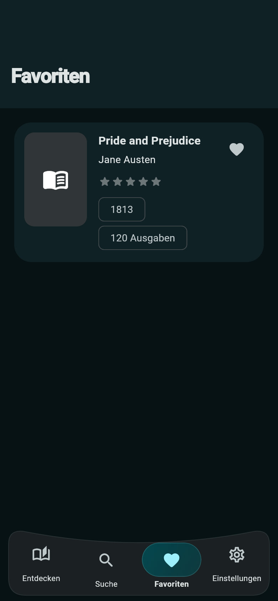
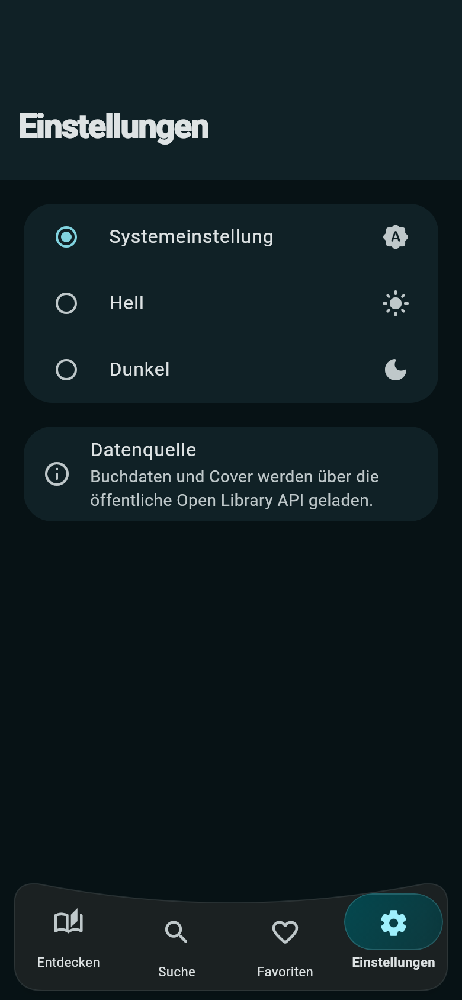

# 📚 Bibliothek

Eine moderne Bücher-App für Android & iOS, gebaut mit Flutter und Material 3. Durchsuche Millionen von Büchern über die
Open Library, speichere Favoriten und vergib Sternebewertungen – mit elegantem Dark Mode.

---

## Screenshots

Die vier Hauptansichten mit der geschwungenen Tab-Leiste und dem Glas-Indikator:

| Entdecken · Hell | Suche · Hell | Favoriten · Dunkel | Einstellungen · Dunkel |
|:---:|:---:|:---:|:---:|
|  |  |  |  |

Die Screenshots zeigen die Flutter-Oberfläche mit festen Beispieldaten und Cover-Platzhaltern bei einer mobilen Bildschirmgröße von 390 × 844. Buchdaten in der laufenden App werden von Open Library geladen.

---

## Features

- 🔍 **Buchsuche** via Open Library (kein API-Key erforderlich)
- ⭐ **Sternebewertungen** für gespeicherte Bücher
- ❤️ **Favoriten** – lokal gespeichert auf dem Gerät
- 🌙 **Dark Mode** mit Material 3 Design
- 🫧 **Geschwungene Tab-Leiste** mit animiertem Glas-Indikator: Tabs antippen oder den Indikator horizontal zum gewünschten Tab ziehen. Die Sucheingabe bleibt beim Tab-Wechsel erhalten.
- 🖼️ **Cover-Caching** für schnelle Ladezeiten

## Architektur

| Bereich               | Technologie        |
|-----------------------|--------------------|
| State Management & DI | Riverpod           |
| Navigation            | GoRouter           |
| HTTP                  | Dio                |
| Lokale Speicherung    | SharedPreferences  |
| Cover-Caching         | CachedNetworkImage |
| Bewertungen           | flutter_rating_bar |

Ordnerstruktur: **Feature-first** (`books`, `favorites`, `settings`)

## Setup

```bash
flutter pub get
flutter run
```

> Falls native Plattformordner fehlen:
> ```bash
> flutter create . --platforms=android,ios,web,macos,windows,linux
> ```
> Der `lib`-Ordner bleibt dabei unverändert erhalten.

## API

Die App nutzt die öffentliche Open Library Search API:

| Endpunkt | URL                                                   |
|----------|-------------------------------------------------------|
| Suche    | `https://openlibrary.org/search.json`                 |
| Cover    | `https://covers.openlibrary.org/b/id/{coverId}-L.jpg` |

## Qualitätssicherung

Einen ausführlichen Code-Audit findest du in [`TEST_REPORT.md`](TEST_REPORT.md).

```bash
flutter analyze
flutter test
```

## Hinweise

Die Verfügbarkeit und Vollständigkeit der Buchdaten hängt von Open Library ab. Favoriten und Bewertungen werden
ausschließlich lokal auf dem Gerät gespeichert.

## Lizenz

Siehe [LICENSE](LICENSE).
